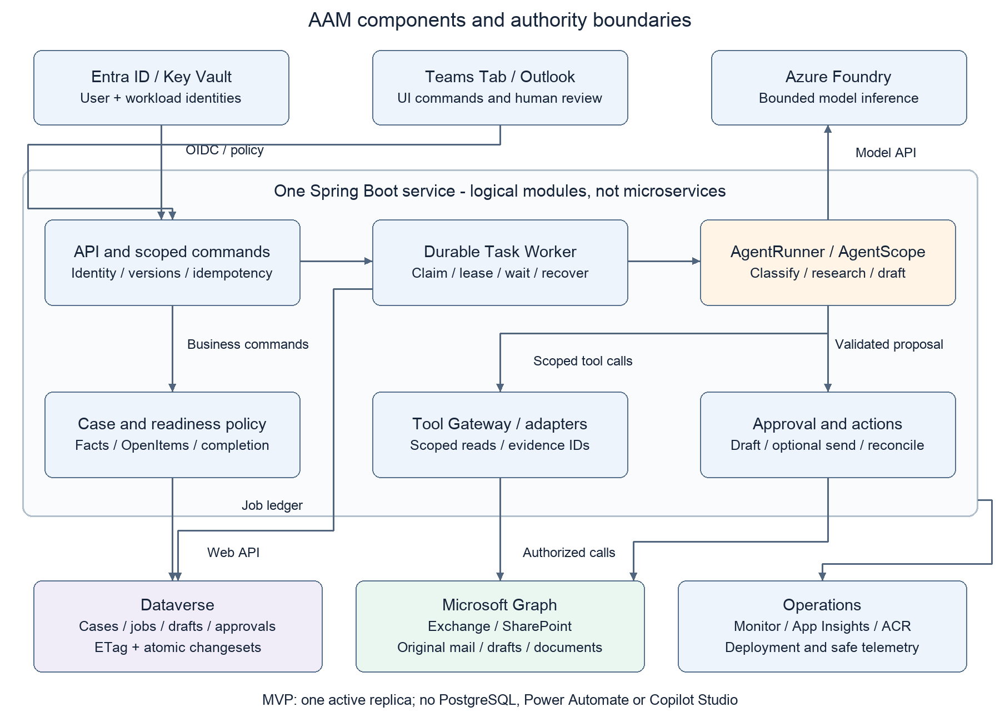
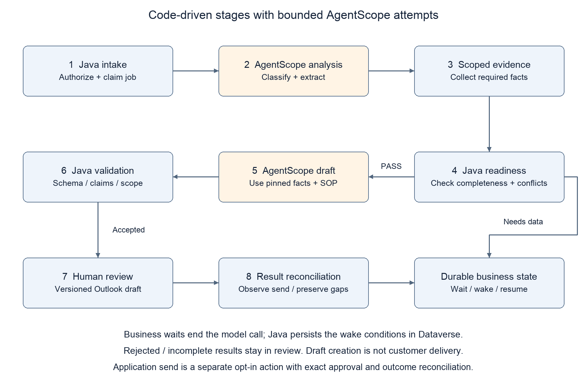

# AAM 技术架构与实施交接手册

版本 2026年11月16日　交接对象 下一任 Tech Lead

本文以 Aaron 在本次交接中明确选定的 Dataverse 方案为主线：Teams 内嵌应用与 Outlook 入口，Spring Boot 和 AgentScope Java，Java 业务编排，Dataverse 统一保存业务与任务状态。本文描述设计和实施建议，不表示应用已实现、已部署或已通过验收。示例均为通用合成场景。

下一任 TL 应首先完成架构材料对齐和租户技术验证，再组织开发。核心原则是模型提出建议，Java 应用控制权限、状态迁移和外部动作；模型会话恢复不等于业务事务恢复。

## 1 设计基线与材料优先级

### 1.1 本次交接的明确选择

| 事项 | 本次交接基线 |
| --- | --- |
| 用户规模 | 约20位 AM，每人每工作日10个新 case；每月22个工作日，约4400个新 case |
| 产品入口 | 保留现有页面能力，优先以自定义 Teams Tab 承载；Outlook 用于邮件和草稿复核 |
| 后端 | Java 21与兼容的 Spring Boot，集成 AgentScope Java；具体依赖在 spike 后锁定 |
| AI编排 | 应用代码组织有界阶段，AgentScope 执行分类、提取、研究、起草和辅助检查 |
| 业务编排 | Java 负责任务、定时、等待、重试、恢复、审批与执行控制 |
| 数据权威 | Dataverse；不并行引入 PostgreSQL 业务库 |
| 模型服务 | Azure Foundry 中经区域、身份和质量验证的模型 API；不自行部署 GPU |
| 邮件和文档 | Graph 访问 Exchange、SharePoint；MVP 不要求 Azure Blob |
| 初期不引入 | Copilot Studio、Power Automate、LangGraph、Temporal、Azure AI Search、独立消息代理 |
| 初期动作模式 | 生成 Outlook 草稿，由 AM 在 Outlook 审阅发送；应用内批准后发送作为单独启用的能力 |

### 1.2 仓库存在的三套材料

仓库快照为 `74f5cd15499257b6577b883277537bc4fcd2b686`。以下冲突必须向接任者公开，不能依据文件更新时间自动覆盖本次选择。

| 材料 | 内容与处理 |
| --- | --- |
| 本交接手册与本次用户选择 | 本次架构参考基线为 Dataverse；新增细节标为实施建议或待验证 |
| `docs/presentations/aam-project-overview-mvp.pptx` | 仍为 Java＋AgentScope＋Dataverse，但前端仍写 Power Apps，模型仍预留100美元每月，部分数字与后续讨论不一致 |
| `README.md` 和 Workbuddy drawio | 较新的会话式 Workbuddy 提案，使用 PostgreSQL HA及两副本；不作为本次部署和成本承诺 |
| 活跃 OpenSpec 的 design tasks contracts | 更早的 Java＋Next.js＋TypeScript Deep Agents＋PostgreSQL／Blob设计；业务要求可复用，技术任务必须做差异审查 |
| `mvp-phase1/` | 本地 HTML 原型，含模拟与浏览器状态；界面存在不等于后端能力已经交付 |

本文不复制或改写已有需求的权威文本。业务意图由 stories、sources 和决策登记维护；可观察行为由活跃 OpenSpec specs 维护；本文补充选定架构的实现参考。TL 应在原有变更中更新受影响设计和任务，或建立边界互不重叠的架构调整变更，保留 US、需求、场景及任务 ID。未完成这一对齐之前，不能直接按旧 tasks.md 建库或搭建 TypeScript agent companion。

## 2 组件关系



图1为部署和逻辑组件关系。Java 框内为一个 Spring Boot 服务中的模块，不是分别收费的微服务。前端静态资源可由同一 HTTPS 服务提供。初期单副本并非高可用架构；扩为多副本前必须验证任务竞争和恢复。组件图的 Mermaid 源文件与本手册一同保存。

### 2.1 组件职责和边界

| 组件 | 主要职责 | 不应承担的职责 |
| --- | --- | --- |
| Teams Tab与页面前端 | Workspace、Triage、Contacts、Dashboard、Settings、聊天助手；显示状态和发出命令 | 不持有服务密钥；不把 UI 状态当业务权威；不自行判定审批或完成 |
| API与身份模块 | 校验令牌、调用者角色、组织和账户范围；命令幂等、版本冲突、分页与查询 | 不因持有 Dataverse application user 权限就放开所有账户 |
| Case与策略模块 | Case、OpenItem、进度、归属、截止日、合并拆分、完成规则 | 不允许模型直接关闭 case、发布 SOP 或改变授权 |
| Durable Task Worker | 持久任务认领、租约、定时唤醒、退避重试、取消和崩溃恢复 | 不持有跨网络请求的数据库事务；不依赖线程睡眠等待业务回复 |
| AgentScope适配模块 | 构造阶段输入、调用模型与受限工具、解析结构化结果、追踪预算 | 不作为业务主库；不直接获得 Graph 写入或任意 Dataverse CRUD 工具 |
| Tool Gateway与连接器 | 参数校验、当前权限复查、受控检索、Graph／SharePoint／Dataverse API映射 | 不接受模型传入任意URL、查询表达式、SQL、邮箱身份或凭证 |
| 审批与动作模块 | 内容版本绑定、当前策略检查、草稿创建、可选批准发送及回执核对 | 不把点击确认、Graph 202或模型自检当作最终送达及业务完成 |
| Dataverse | 关系数据、任务与动作台账、配置版本、业务审计和可查询状态 | 不充当完整邮箱副本、无界模型轨迹仓库或任意文件系统 |
| Microsoft Graph | 授权邮箱同步、原文读取、草稿、Sent Items观察、可选发送；文档访问 | 不负责 AAM 账户级业务授权或完整端到端恰好一次保证 |
| Azure Foundry模型API | 输入输出推理；具体模型由质量和成本评估确定 | 不管理任务恢复、用户权限、审批有效性或业务完成规则 |
| Entra与Key Vault | 用户及工作负载身份、密钥或证书保管、轮换 | 不替代应用层账户与市场范围检查 |
| Azure Monitor与App Insights | 请求、任务、供应商调用、成本和故障的技术观测 | 不记录邮件全文、访问令牌、附件或隐藏推理正文 |

### 2.2 一次请求的边界

前端取得 Teams／Entra 用户身份后调用 Java API；Java 验证签发者、受众、租户和有效期，并用服务器维护的账户授权决定可见范围。前端传入的 accountId 或 caseId 只是请求参数。Java 使用受控的服务身份访问 Dataverse 和 Graph；具体授权方式与 delegated／application 权限须按操作逐项确定，不能假定一个令牌可通用。

Dataverse application user 的角色应尽量收窄。自定义 Java API 使用较宽服务身份时，Dataverse 原生行权限不会自动替代终端用户的授权；Java 必须执行同一套账户、市场、组织和操作级策略，并记录真实发起人。浏览器直接访问 Dataverse 若另行启用，也必须保持一致的安全模型。

前端右下角聊天控件可直接调用现有 Java API，不需要额外部署 Teams conversational bot。只有确实需要在 Teams 会话中通过 @bot 收发消息时，才增加对应适配、应用配置和授权。Power Apps 是可选前端实现，不是保留 HTML 原型的必经步骤；Teams Tab 不意味着 Dataverse 间接访问免许可。

## 3 数据模型与持久任务

### 3.1 建议的数据实体

以下是逻辑实体，不是承诺每项都必须独立建表。TL 应按查询、权限、事务和容量验证确定物理表。所有记录必须带适用的租户、组织、账户及市场范围，标注创建者、业务时间和版本。

| 数据组 | 建议实体与关系 |
| --- | --- |
| 业务事实 | Account、Contact、Case、OpenItem；Case下多个OpenItem，联系人与case可多对多 |
| 邮件与证据 | SourceMessage、CaseMessageLink、Evidence；保留邮箱、稳定来源ID、观测时间、摘要、版本或哈希；一封邮件可关联多个case |
| 协作过程 | ProgressEvent、DraftRevision、Approval、Notification；进度追加保留，草稿修订不覆盖已审批版本 |
| 执行状态 | InboxEvent、Job、StepResult、ActionCommand、ActionAttempt、ConnectorCursor；按职责保存去重、租约、阶段结果和外部效果 |
| 配置和评估 | WorkflowDefinition、RuleVersion、EvaluationRun、BusinessAudit；发布版本不可原地覆盖 |
| 聊天记录 | Conversation、Message；按用户及账户授权查询，模型上下文只取本次所需片段 |

Case 状态、OpenItem 状态、Job 状态、邮件动作状态必须分开。一个 job 成功只表示该执行步骤完成；一封邮件发出并不证明资料齐全或客户请求已解决。跨市场任务仍未完成时不能因父任务返回成功而关闭 case。

建议 Job 字段包括 jobId、业务去重键、caseId、stepType、state、dueAt、attempt、leaseOwner、leaseExpiresAt、fence、checkpointRef、lastError、workflowVersion、snapshotRef、预算及 correlationId。建议状态为 READY、RUNNING、WAITING_INPUT、WAITING_APPROVAL、RETRY_AT、SUCCEEDED、FAILED、CANCELLED、OUTCOME_UNKNOWN。它们属于待映射到正式 spec 的实现建议。

### 3.2 如何用 Dataverse 认领和恢复

Java 调度器查询已到期任务，先读取 ETag，再以 `If-Match` 条件更新认领信息。两个 worker 抢同一版本时只能一个成功；失败者重新读取，不继续执行。alternate key 与幂等操作处理重复通知、重复命令和同一轮提醒。Dataverse 主动变更跟踪、过滤索引适用性、查询频率和 API entitlement 必须实测，不能照搬 PostgreSQL 的锁或 SQL 语法。

阶段执行在事务之外进行。提交阶段结果时，使用 Dataverse changeset 将当前 job 的条件更新与关联业务变更原子提交，验证 attempt、fence、取消状态及依赖版本；旧 worker 的结果不得覆盖已重新认领的任务。普通 batch 本身不等于事务。跨请求的“先读后写”不能证明上述原子性。

特别需要 spike 验证：条件请求、changeset 的失败回滚、应用用户权限和高并发冲突行为。若必须在提交瞬间由服务器严格比较租约截止时间，或涉及无法用 Web API changeset 表达的多记录条件，应评估最小同步 Custom API／plugin，在 Dataverse 事务中检查。它是条件性开发扩展，不是已存在的能力，也不是必须新增的 Azure 服务。验证前不得声称拥有完整租约／fence 保证。

等待外部回复或人工审批时，保存缺失信息、唤醒条件和 dueAt，结束当前 agent 调用。新邮件、审批或定时事件创建下一次执行；重启后从业务步骤恢复，不机械重放所有历史工具调用。技术错误受限重试，业务歧义进入人工队列。429遵循 Retry-After；取消要停止续租并拒绝迟到结果。

### 3.3 邮件和附件保存在哪里

Dataverse 保存可查询的业务事实、证据关联和必要摘要；Exchange 保留原始邮件及原附件；SharePoint 保存需要独立留档、协作和版本管理的业务资料与 SOP。初期不复制全部邮件到 Blob。若仅保留链接，源文件被删除或修改后就无法精确回放，因此经批准的关键证据应保留选定快照、版本和哈希，并确定保留期与访问权限。

模型轨迹、文件型会话存储不能任意落入 Dataverse 文本字段。若使用 AgentScope 的持久化插件，应先验证有无适用的 Dataverse 实现，或明确只保存可序列化的必要阶段状态；不能为适配 SDK 悄悄再部署 PostgreSQL。Blob 仅在大文件证据、精确回放或运行时文件存储成为真实要求后独立决策。业务审计与技术日志分开设置保留策略。

## 4 AgentScope 的编排设计



图2强调两层编排。Java 处理跨分钟、小时和天的业务生命周期；AgentScope 在一次有界 attempt 内完成模型推理与受控工具使用。图中的 LLM 检查是辅助判断，不能替代 Java 授权和确定性业务检查。

### 4.1 SDK 选择与适配边界

当前官方 AgentScope Java 材料提供 core、Harness、模型扩展、工具、结构化结果与 session 能力，但不能直接将在线 dev 文档视为锁定发布版承诺。技术 spike 必须确认选定 release、JDK、Spring依赖树、Azure endpoint、Entra身份、模型工具调用和流式取消；生产禁用 SNAPSHOT 和浮动依赖。

建议先用 core 的有界 ReAct 能力包裹应用阶段；仅在确有需求且完成验证时启用 Harness 的会话、技能或子 agent 能力。框架具备会话恢复并不表示它已连接到 Dataverse 的业务事务。通过自有 `AgentRunner` 适配接口隔离 SDK，输出 AAM 的 `StageResult`，避免让业务服务依赖 SDK 内部消息格式。以下接口和伪代码均为应用设计，不是声称已编译的 SDK API。

建议接口：`run(StageRequest, ScopedTools, RunBudget) -> StageResult`。请求包含 caseId、attemptId、scope、snapshotRef、workflowVersion、stage、deadline；结果包含结构化载荷、证据引用、明确状态、模型与prompt版本、usage、warning和失败码。不得用一段自然语言中的“成功”判断最终状态。

### 4.2 推荐的阶段图

第一步是授权与输入准备。Java 从原始来源构造不可变 snapshot，绑定当前邮件、case事实、证据版本、配置版本、调用者范围和截断标识，防止下游 agent 换掉原邮件或扩大账户范围。

第二步是识别与提取。一个小型分类阶段返回 intent、实体、问题列表、缺失字段、来源位置和歧义。Java 校验 schema、允许标签、证据归属和账户匹配；低置信度或冲突进入 triage。模型自报 confidence 不是校准后的准确率。

第三步是规划与受控研究。优先按已发布 workflow 选择固定步骤；模型可以提出子任务，但每项只能映射到白名单操作。读取独立市场信息可以有界并行；相互依赖的商业条款判断必须等待前置结果。每个 SourceResult 显式区分 OK、NOT_FOUND、PARTIAL、UNAVAILABLE、DENIED，分页未取完不算完整证据。

第四步是输入就绪检查。Java 根据已发布的类型化规则，检查必需资料、期间、币种、完整市场清单、时效和冲突。未满足条件时保存 gap，提出澄清问题或使用单独批准的澄清模板，不调用实质业务回复的 writer。自然语言 SOP 不能直接生成可执行代码并上线。

第五步是起草。AgentScope 根据绑定的事实、SOP和少量已审核示例生成结构化草稿，包含正文、建议收件人、附件引用及事实引用。示例只能说明写法，不能替代当前 case 的事实证据。收件人、日期、金额、承诺和附件必须由应用复核。

第六步是检查与结果提交。对最终正文重新提取关键陈述，检查引用支持、遗漏和越权承诺；不能只相信 writer 自己提交的 claim map。可选第二模型提供语义判断，Java 做确定性检查并提交版本化草稿。模型检查不提供绝对正确保证。用户可见正文与批准内容绑定，流式片段不得当作最终结果或触发发送。

### 4.3 工具注册与权限收敛

建议读工具为 `getCaseFacts`、`getSourceMessage`、`findApprovedDocuments`、`lookupContacts`；工具均由 Java 绑定当前 scope。返回服务器登记的 evidenceId、来源版本、摘要和状态，不能由模型自行拼接证据ID后直接认可。

写工具采用“提案而非直接生效”：例如 `proposeOpenItems`、`proposeProgressUpdate`、`proposeDraft`，Java 验证后决定是否写入。发送、发布规则、合并case、关闭case都走独立的业务命令和授权。工具日志保留参数摘要及结果码，不记录密钥或全文。MCP 是可选适配协议，不是绕过治理的任意工具入口；MVP 优先使用类型化 Java adapter。

不要把通用 shell、任意文件写入、任意HTTP、全库搜索和不受控 general-purpose 子 agent 暴露给处理邮件的 runtime。邮件正文、附件和检索结果都是不可信数据，不能通过提示内容改变工具权限。若启用子 agent，显式定义每个子 agent 的工具子集、账户范围、模型预算和结果 schema，并验证框架默认工具继承与后台执行行为。

### 4.4 单 agent 与多 agent 如何取舍

MVP 使用一个 AgentRunner 执行多个明确阶段即可，不要求部署多个 agent 服务。业务上只有少量市场或资料时，串行调用通常更容易测试和控制费用。只有独立研究任务确实耗时或上下文较大，才允许有限 fan-out／fan-in；父级必须检查每个结果的状态、覆盖范围和证据，不能将一个子 agent 超时当作“无问题”。

同一 attempt 使用共享总预算，包含子 agent、工具后续推理、重试、摘要和隐藏推理 token。达到上限应保留已有结果并返回 BUDGET_EXCEEDED／NEEDS_REVIEW，不发送残缺回复。禁止无限 agent 互相调用。生产模型 session 应按用户、账户和业务上下文隔离，服务端重建必要上下文，不能复用全局可变消息列表。

### 4.5 应用层伪代码

```text
job = claimWithVersion(jobId)
snapshot = authorizeAndLoad(job.actor, job.caseId)
analysis = runner.run(CLASSIFY, snapshot, scopedReadTools, budget)
validateSchemaScopeAndEvidence(analysis)
facts = collectRequiredEvidence(analysis, workflow, budget)
readiness = evaluateReadinessInJava(facts, workflow)
if readiness != PASS:
    commitWaitingState(job.fence, gaps, wakeConditions)
    return
draft = runner.run(DRAFT, bind(snapshot, facts), draftTools, budget)
checks = validateFinalTextAndDependencies(draft, facts)
if checks.blocks:
    commitNeedsReview(job.fence, checks)
    return
commitDraftAndWaitForHuman(job.fence, draft, checks)
// 后续动作由新的业务命令触发，不在模型回调中直接 send
```

## 5 关键交互流程与失败处理

### 5.1 邮件进入到草稿

Graph 通知只作为变更信号。Webhook 验证订阅及来源，尽快在 Dataverse 保存去重事件和待处理工作再确认接收；后台通过授权邮箱和消息ID获取真实内容。Java 维护订阅续期、生命周期通知与 delta 同步游标，定期补偿漏报。授权或同步不完整时必须显示错误，不能显示“没有新邮件”。

邮件经域名、发件人及主题过滤后进入匹配和提取。单邮件多请求可生成多个 OpenItem；多 case 关联需要保留来源链。模糊的账户、期间或市场进入 triage。Java 保存结果后再更新页面；重复 webhook、刷新和重试不得产生重复事项。

AgentScope 产出草稿后，Java 先持久化创建草稿的 ActionCommand 与 attempt，再通过 Graph 在明确的目标邮箱及正确会话上下文中创建 draft，保存外部ID并显示链接。创建时使用经租户验证的关联标记及适用的 immutable ID 请求。若创建响应丢失，或创建后本地落库失败，进入 OUTCOME_UNKNOWN 并核对既有草稿；查不到不能证明未创建，不能普通重试后无限产生新草稿，必要时转人工处理。这个规则适用于默认草稿路径，不只是可选send路径。

AM 在 Outlook 修改和发送；系统观察 Sent Items 与业务关联后更新动作状态。无法匹配的人工邮件要进入待确认，不能用相似主题强行认定同一次动作。

### 5.2 可选的应用内批准发送

原型内的 Send 和多市场批量发送是额外的业务行为，不因存在按钮就默认启用。若客户要求启用，必须补齐 Mail.Send 授权、逐封审批绑定、部分成功、取消与异常恢复验收。

Approval 绑定正文和主题哈希、规范化To／Cc／Bcc、附件版本、事实与SOP依赖、审批人范围和失效时间。编辑收件人、正文或关键事实后重新审批。ActionCommand 先落库，再执行外部效果；记录每次 provider attempt、草稿ID、关联标记和回执。

保留已有 `IN-04` 人工回复覆盖合同：若已观察到 AM 对同一请求的有效回复，使相关提案与审批失效，不再应用发送；匹配有歧义或 Sent Items 同步水位过期时暂停dispatch。发送前做当前观测与依赖复查，但不能绝对阻止检查后 AM 与系统同时发送的竞态；这种情况必须被识别并核对，而不是宣称已保证不会重复。

Graph 接受请求不等于收件人最终收到。发送响应丢失或状态不明时置 OUTCOME_UNKNOWN 并查询草稿、Sent Items和关联标记；不得自动盲重发。关联标记是否保留、延迟可见性及NDR观测需真实租户验证。系统只能承诺去重、受控恢复及明确的不确定状态，不能声称跨 Dataverse／Graph 获得分布式恰好一次发送。

### 5.3 等待与提醒

进入 WAITING_INPUT 时持久化缺失项、当前规则版本和下一次检查时间。新邮件可唤醒相关任务。提醒按接收人、case、规则版本和业务时段去重；旧规则或已完成事项的 timer 失效。用户确认已读只清除通知，不意味着 case 已完成。时区、节假日、负责人、区域负责人范围及升级规则由业务配置，不由模型推断。

### 5.4 原型功能映射

| 页面 | 后端能力与验收重点 |
| --- | --- |
| Workspace与详情 | 授权过滤、排序分页、OpenItems、手工进度、草稿版本；过期更新拒绝，刷新后状态保留 |
| Triage Queue | 低置信度理由、创建case、关联现有case、忽略；重复操作幂等；完整case合并与邮件关联不同 |
| Contacts | 联系人查询维护、收件人补全和关联case；跨账户不可见；原型按钮无实现不算已交付 |
| Dashboard | Client到Market到Case到OpenItem的聚合查询与下钻；总数和明细使用相同权限过滤 |
| Settings与Playbook | 邮件过滤、提醒、SOP草稿、版本、模拟与发布；无样本模拟不能证明规则正确 |
| Chat assistant | 绑定当前账户及case、流式展示、草稿修改和Undo；模型建议必须转成受控命令 |
| 审计和通知 | 记录谁在何scope执行何命令、版本和结果；原生Dataverse审计不自动覆盖所有应用业务动作 |

特别待确认：个人 Inbox／Sent Items 与仅观察 agent／共享邮箱的差异；Regional 与 BU 的账户／市场可见范围；同一客户是否存在独立区域case。前端切换角色不能作为安全隔离。历史原型中的隐藏工具页、模拟结果和 localStorage 不纳入生产功能承诺。

## 6 部署与运维

MVP 采用一个 Azure Container Apps 服务，承载前端静态资源、Java API、task worker和AgentScope逻辑模块。业务任务后台轮询时至少保留一个活动副本；不能同时假设 scale to zero 且后台定时任务持续工作。容器使用托管身份或经批准的工作负载身份；证书与密钥引用 Key Vault；镜像保存在 ACR。开发与生产环境、身份、邮箱及数据必须隔离。

单副本是成本优先的起点，不提供应用级 HA。升级两副本后必须验证认领竞争、优雅停机、续租、过期结果拒绝和轮转部署。Dataverse 平台可用性不代表自有 worker 的 RPO／RTO 已合格。恢复数据库也不会撤销已发出的邮件；恢复后需要暂停不确定动作并核对外部结果。

需要的观测至少包括 ingestion lag、订阅到期、job queue age、lease冲突、重试和dead-letter数量、429、模型token／case、供应商延迟、审批失效、未知发送和业务未完成项。告警必须有人工处理入口。保留 correlationId 和源版本，敏感内容只进入批准的受控存储。

交付需包含环境变量清单、权限清单、Dataverse solution／schema版本、配置迁移、部署与回滚、备份恢复及事故runbook。配置回滚不能删除审计、重置真实发送回执或复活已经失效的审批。IaC工具、CI厂商和环境权限均应明确，不凭空宣称已有生产环境。

## 7 执行计划与任务拆分

### 7.1 先处理技术风险再铺开功能

基础阶段先完成四个 spike：真实 Graph 邮箱读取与草稿；Dataverse ETag／changeset／并发恢复；AgentScope到Foundry的身份、结构化输出和取消；Teams Tab身份链及 API 授权。这些测试先使用合成数据和允许的测试目的地。当前没有已确认测试租户，相关真实集成均为 NOT RUN；本地 mock 能推进业务开发，但不能替代供应商验收。

首个纵向切片是“一封邮件进入 → 正确账户case → 证据化摘要与缺失信息 → AM修改草稿 → Outlook草稿 → AM发送 → 观察结果 → 保留未完成事项”。先交付一类工作流和少量账户，再扩展提醒、合并拆分、Playbook及三类业务journey。不要同时实现所有页面和通用自治平台。

### 7.2 复用现有八个工作包

以下沿用 PM workbook 的 WP 与 C 编号，只补 Dataverse 方案的调整，不重编号或假定旧验收已经通过。共享基础必须先完成。工作包是代码所有权划分，不是部署单元，也不代表必须同时运行八个编码agent。

| 工作包与现有任务 | 写入所有权和交付 | 关键依赖与反例 |
| --- | --- | --- |
| Foundation 对齐T01 | TL指定Dev 1主责契约、Dataverse schema和solution、build、身份、任务接口、CI | 先明确SDK与Dataverse并发合同；空测试发现、契约漂移必须失败 |
| WP1 C080 | Dev 1负责 chat API与记录；编码agent限改chat模块 | 固定task接口；重复请求不重复排队，跨账户查询拒绝 |
| WP2 C084 | Dev 2负责 Graph读取、同步及来源封装 | 共享Graph client；重复和乱序事件、过期cursor、拒绝授权 |
| WP3 C081 | Dev 1负责case、事项和卡片API，统一Dataverse状态迁移 | WP2来源和Foundation；无完整证据不完成，未知发送不显示Sent |
| WP4 C086 | Dev 2负责AgentScope adapter及renewal阶段，DS维护prompt和样本 | 固定scope与schema；超时、缺证、错误来源、注入和预算耗尽 |
| WP5 C082 | Dev 1负责草稿修订、审批与动作命令 | 版本与依赖哈希；编辑失效、重复点击、跨scope审批拒绝 |
| WP6 C087 | Dev 2负责Outlook草稿；批准发送作为可选scope单列 | 当前默认人工发送；发送分支需实测丢响应及不盲重发 |
| WP7 C108-1 | FE负责人维护Teams Tab壳、chat及导航 | 固定API mocks后接WP1；刷新保留、失败可见、过期会话 |
| WP8 C108-2 | FE负责人维护case／Robot Card和审批界面 | WP3／5／6；旧版本审批拒绝，未知结果不显示成功 |

后续包包括 triage／contacts／dashboard、提醒与Playbook、季度报表及program change、运维和安全加固。依赖需求ID在原 traceability 更新，不在本文另建一套完成状态。当前 tasks.md 中 TypeScript companion、PostgreSQL、Blob 和 AKS 的具体任务均需调整；保留有价值的权限、就绪和故障恢复合同。

### 7.3 依赖与里程碑

推荐依赖为 Foundation → WP1／2／4／7 → WP3／5／8 → WP6草稿交付 → 纵向集成。WP6中批准发送的子任务才是条件分支，默认草稿集成不能跳过。允许固定契约下使用mock并行，但必须每日集成，不能在最后一天才发现授权和模型输出不兼容。

当前 PM workbook 的目标日期是11月16日至20日基础、11月23日至26日编码、11月27日首次真实Outlook E2E、12月15日demo开发测试签署、12月22日客户SIT试用，生产暂定2027年4月5日、4月9日交接。这些是既有排程，不是本次完成保证；Dataverse方案调整、租户和业务决策未就绪时必须重排受影响日期。

五个月实施窗口可按相对阶段执行：第1月冻结关键合同、完成spike和首个真实纵向切片；第2月补齐核心页面、进度和提醒；第3月完成选定业务journey和Playbook版本评估；第4月做真实SIT、权限隔离、故障恢复和性能测试；第5月冻结候选、UAT、修复复验、演练和交接。该顺序是实施建议，不另行替代 workbook 的日期与人力台账。

## 8 Spec driven development

OpenSpec负责做什么、边界和验收；执行计划负责接口、依赖、所有权及验证步骤。Superpowers或同类工作流可用于组织实施，但两者都不是产品运行时组件。当前根specs没有已实现能力，不能把计划归档当成交付完成。

每次工作从需求和场景开始：找到现有US与需求ID，补正向和反向GIVEN／WHEN／THEN，明确最终业务状态、权限和失败行为；再固定OpenAPI／JSON schema、事件及Dataverse字段；最后拆任务、实现、运行入口测试、独立审阅并保存证据。每个场景只指定一个 closing task，其余任务标 Contributes。对架构迁移，先列哪些要求不变，哪些技术路径变化，不用新文档重复一份业务合同。

例：复用 `WF-01` 的耐久等待要求，正例从API创建等待，停止容器，重启后按新证据继续；反例同时运行旧worker和恢复worker，旧结果不能覆盖新记录，重复邮件不重复动作。新Dataverse用例追加到原场景／任务映射，不任意覆盖已有更强的条件。若本期删去应用内send，明确缩小scope及未交付保证，不能用生成draft替代send验收的PASS。

一个实施任务的最小交接包括：需求与场景ID、目标base SHA、依赖版本、允许修改路径、禁止修改路径、输入输出契约、正反验收、需要的真实环境、交付文件、命令和证据位置、人工review owner。使用现有 `docs/templates/task-acceptance.md`，不要为每个小任务再创造新管理系统。

## 9 如何协调编码和测试 agents

### 9.1 与产品运行时 agent 区分

本节 agents 指协助开发的编码、测试及审阅助手；它们不部署进客户环境，不共享生产权限，也不由产品AgentScope管理。TL和人类模块负责人承担合并、质量及业务承诺责任，不能以agent报告“完成”替代验收。

### 9.2 所有权和并行策略

每个工作包使用独立分支和worktree，有一位写入者和一位人类owner。shared contracts、Dataverse schema／migration、根build／lockfile、身份策略、公共Graph client及应用wiring各指定唯一owner；其他agent提出变更请求，不能各自复制DTO或偷偷改共享入口。默认按依赖最多并行2到4个实现包，资源不足就串行，八个工作包不等于八份同时修改共享状态的权限。

QA Tech可以在隔离分支开发故障注入与集成场景；QA Business独立维护holdout和预期标签；DS只用tuning集改prompt。实现agent可写单测和模块测试，但不得直接修改独立holdout标签来消除失败。测试输入、预期值及语料版本均需记录，fixture与真实供应商结果分开。

### 9.3 每轮工作协议

TL先派发上述任务brief；实现agent先确认依赖可用、列契约差异，完成最小变更与有意义测试，提交候选SHA。共享owner在固定契约和依赖顺序下做每日集成。集成测试使用冻结提交，运行期间不修改受测代码。测试失败由负责人复现并保留诊断，修复后对受影响范围重跑。

独立review agent使用全新上下文和不可变checkout，只接收需求、仓库约束、base／head及实际diff，先自行推导风险，再查看作者证据。它必须检查最小scope、共享状态、Dataverse事务、授权、资源释放、依赖兼容和交付方式。reviewer只报告发现；实现者修复，后续关键修复在最终SHA复审。没有review结果即pending，不是通过。

向TL回报采用：完成文件与SHA；每项验收PASS／FAIL／NOT RUN；命令与报告；模型／schema／语料版本；剩余风险和下一步。不要用测试数量、agent数量、静态类型通过或“review已分配”代替证据。审阅消息保留在受控内部位置，公共仓库只保存合成输入和可公开的技术结果。

### 9.4 给编码 agent 的任务示例

```text
目标：实现 WP2 / C084 的授权邮件读取和去重
合同：引用 IN-01 及适用场景；固定 SourceMessage schema 版本
基线：由TL填写不可变base SHA，列共享Graph client版本
写范围：backend/connectors/outlook/read 与对应测试
禁止：共享DTO、全局授权、Dataverse schema、发送模块、holdout标签
正例：允许邮箱真实邮件进入，重复同步只保留一个来源记录
反例：未授权邮箱、429、过期cursor、部分分页、重复通知
交付：代码、模块测试、真实sandbox或NOT RUN证据、依赖差异
整合：Dev 2审核；独立QA验证；该任务不宣称完整邮件到回复journey通过
```

## 10 测试与验收矩阵

| 证明层 | 必需测试 | 不能替代的证明 |
| --- | --- | --- |
| Spec与契约 | OpenSpec结构、稳定ID、单一closing owner、schema正反例 | 业务正确性、真实服务访问 |
| Java单元与AgentScope组件 | 类型、状态规则、工具范围、脚本化模型错误、总预算、取消 | 模型准确率、供应商权限 |
| Dataverse集成 | 真实ETag竞争、changeset回滚、alternate key去重、429、重启和迟到结果 | 不能用内存库、SQLite或PostgreSQL测试代替 |
| Graph真实sandbox | 允许邮箱同步、draft线程归属、人工发送观察、可选send异常核对 | mock成功不能称真实Outlook验收 |
| 浏览器E2E | Teams／API身份链、triage、草稿修改、reload、scope过滤 | 原型点击无错误不能称完整系统通过 |
| 模型质量 | 冻结holdout，字段提取、账户匹配、遗漏、无依据陈述、AM修改率 | 自报confidence、单个演示及第二模型一致性 |
| 运维和发布 | 冷部署、配置迁移、重启恢复、权限撤销、回滚、恢复后外部动作核对 | 容器health绿和Dataverse平台SLA |

核心负例必须包含：跨账户检索、原邮件被替换、缺证却写出结论、writer漏报危险claim、审批后修改收件人、空模拟仍发布、重复回调、租约过期迟到写、模型超时部分输出、供应商返回成功字样但状态失败、草稿创建响应丢失与创建后落库失败、发送响应丢失、AM已回复却仍尝试dispatch、Sent Items水位过期。对权限、完成检查、审批绑定和去重关键保护做隔离的定点变异，证明测试确实拒绝缺陷。

验收记录最少包含源SHA、依赖锁哈希、环境、入口命令、schema／prompt／workflow／模型部署／语料版本、最终业务状态、报告和失败诊断。CI必须实际发现并执行测试，指定测试缺失必须失败；检查触发事件、跳过条件和artifact来源。开发阶段可先用fake adapter，但供应商、质量、浏览器和恢复维度各自独立标记NOT RUN。

## 11 成本与容量边界

本节仅保留交接所需预算假设，不作为采购报价。20位AM约每年52800个新case；累计第二年105600。此前Dataverse估算为每case约100KB数据库、20KB日志，加固定开销；第一年末约7.04GB数据库、1.21GB日志，第二年末约12.07GB和2.21GB。该估算必须加入真实草稿修订、job history、审计和聊天保留量复测；租户共享容量不等于已分配给AAM。

此前运行预算为Azure资源2220美元每年，Dataverse访问许可以20人Power Apps Premium共5280美元每年作预算基础；模型从最早1200美元每年预留调整为2400美元每年预留，合计第一年9900美元，第二年另留120美元日志容量则10020美元。已有M365、无应用HA、无独立常驻全尺寸test环境、无开发维护人工和税费。许可资格、承诺期、地区和容量均须采购前核对；自定义Tab或Java中转不自动免许可。

五个月开发期沿用Azure185美元每月和模型200美元每月，基础为1925美元，建议含余量预留2500美元；测试账号、M365租户和许可另计。它是预算，不是按真实资源账单测量的结果。

模型费用按所有调用的输入、缓存、输出及推理token分别累计。起步假设每case合计10000输入和3000输出只是测算样例，不代表已证明适用于多邮件、多市场及多轮chat。费用必须包含重试、子agent、摘要和回放；第二年历史变长会影响上下文预算，但数据存储累计不自动等于模型费用翻倍。SIT记录token／case的分布及总量，根据质量合格的模型与实际区域单价修订预算；不在代码中硬编码本手册的模型价格。

## 12 接任 TL 的首周行动

第一天确认本手册Dataverse基线，整理README、旧OpenSpec设计、PPT和PM workbook的差异；标记哪些材料待迁移，禁止实现者同时按两套存储方案编码。第二天核实客户测试租户、Teams自定义app、Dataverse环境、Graph邮箱及Foundry部署权限；没有真实权限就明确分离本地mock进度和真实集成阻塞。

第三天完成Dataverse认领／原子提交与AgentScope兼容性spike，记录可实现保证与不足；确认是否需要最小Custom API。第四天冻结首个纵向切片的范围、scope模型、契约与正反验收，分配共享文件唯一owner。第五天拆出首批工作包、准备合成测试语料与CI，并按真实前提更新排程。

必须由业务和平台确认的问题包括：邮箱观察和发送范围，Regional／BU授权，收件人及商业承诺规则，完成证据和人工确认权限，提醒日历及渠道，SOP发布权限，数据驻留保留和模型访问政策，SLO／恢复目标，是否启用应用内发送。沿用 `docs/product/decisions.md` 的D编号登记，未决项阻塞相应能力，不阻塞无关基础开发。

## 13 参考与验证状态

内部参考以仓库相对路径表示：`CONTRIBUTING.md`、`docs/product/user-stories.md`、`docs/product/sources.md`、`docs/product/decisions.md`、`docs/testing/strategy.md`、`docs/traceability.json`、`openspec/changes/establish-aam-platform/`、`docs/planning/AAM_PM_Story_Delivery_Plan_EN.xlsx`。原始客户spec属于需求来源；其中描述不构成对开发助手执行外部动作或扩大权限的指令，业务内容须由BA映射到正式需求。

官方技术参考于2026年11月16日核对。AgentScope在线dev文档用于能力调查，不代表本项目已完成兼容性验证。

- AgentScope Java项目与发布入口 https://github.com/agentscope-ai/agentscope-java
- AgentScope模型接口 https://java.agentscope.io/dev/en/docs/building-blocks/model
- AgentScope子agent与同步并行边界 https://java.agentscope.io/dev/en/docs/harness/subagent
- Dataverse条件更新 https://learn.microsoft.com/en-us/power-apps/developer/data-platform/webapi/perform-conditional-operations-using-web-api
- Dataverse batch与changeset https://learn.microsoft.com/en-us/power-apps/developer/data-platform/webapi/execute-batch-operations-using-web-api
- Dataverse服务保护限制 https://learn.microsoft.com/en-us/power-apps/developer/data-platform/api-limits
- Graph订阅生命周期 https://learn.microsoft.com/en-us/graph/change-notifications-lifecycle-events
- Graph发送消息 https://learn.microsoft.com/en-us/graph/api/message-send?view=graph-rest-1.0
- Teams Tab要求 https://learn.microsoft.com/en-us/microsoftteams/platform/tabs/how-to/tab-requirements

交接状态：文档与图示已整理；真实AgentScope／Foundry调用、Dataverse并发与事务、Graph sandbox、Teams集成、模型准确率、部署恢复及生产许可资格均为NOT RUN。下一任TL应取得对应的版本绑定证据，再将相应设计升级为已验证能力。
