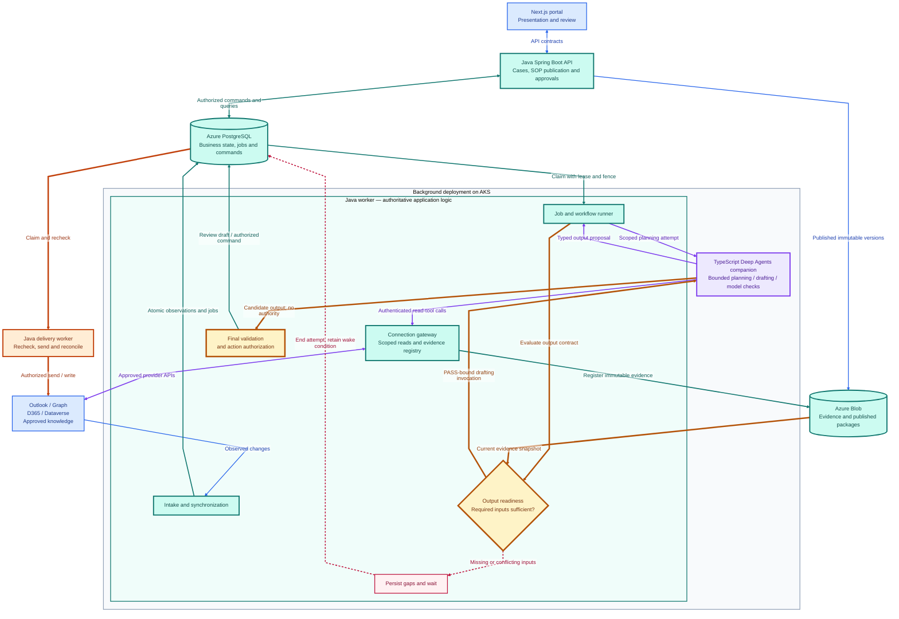
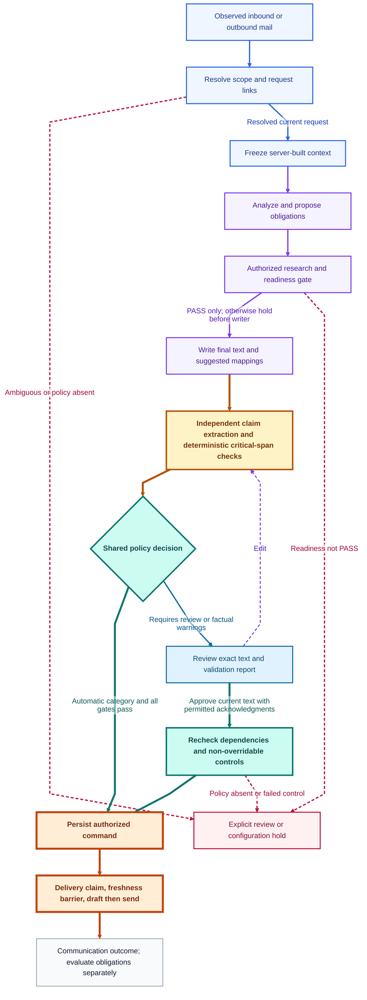
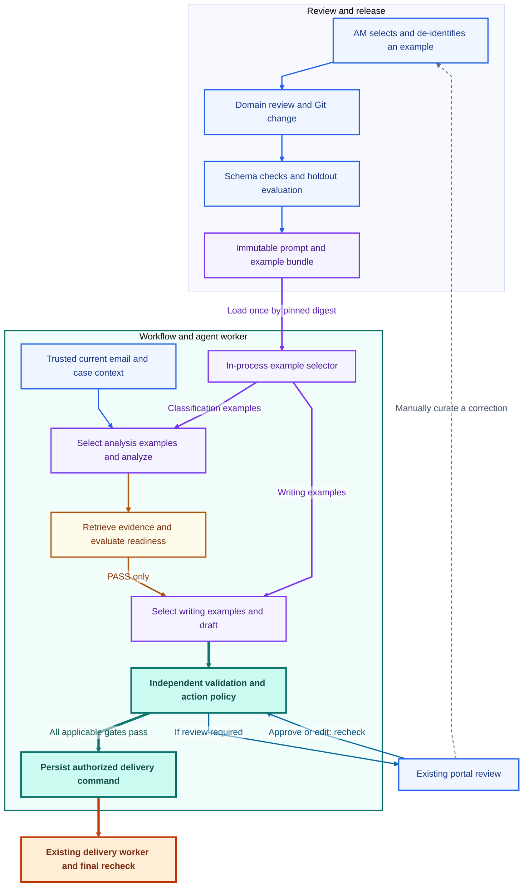

## Context

Status: proposed architecture, not an implemented system. See [proposal](proposal.md), [stories](../../../docs/product/user-stories.md) and [decision register](../../../docs/product/decisions.md). Business-owner questions are activation prerequisites, not engineering-authored answers.

## Goals / Non-Goals

**Goals:** durable case coordination; independently tunable mail understanding; scoped, evidence-backed actions; extensible client workflows; maintainable managed Azure deployment. Deliver a deterministic quarterly local reporting slice before coupling the journeys to model-generated replies.

**Non-Goals:** autonomous underwriting; an LLM controlling authorization; one service per specialist; self-hosted databases/brokers/workflow servers; deciding unresolved business policy. This change implements no application and provisions no services.

## Decisions

### Components and data flow

The core backend uses Java/Spring Boot for API, cases, workflow execution, intake, connections, evidence, readiness, approvals and delivery. Next.js/TypeScript remains the presentation layer. Deep Agents TypeScript runs as a bounded companion to the Java background worker, with no direct business database access or external write credentials. Four deployment roles share one product repository: portal, Java API, Java background with agent companion, and Java delivery. The Java backend is a modular application with shared domain modules and separate launch profiles/identities, not a service per module. Managed PostgreSQL owns business state and durable jobs; Blob holds evidence and versioned packages; AI Search is derived knowledge data.



Blue = portal/publication/intake; teal = Java-owned state and evidence; violet = bounded agent execution and scoped read calls; thick amber = readiness, drafting and final validation; dashed rose = hold; orange = external delivery. The background pod contains the Java worker and its TypeScript agent companion. The portal and companion have no direct business-state mutation authority. Entra, Key Vault, ACR and Azure Monitor support the four deployment roles. The graph groups external systems for readability; read and delivery identities remain separate.

**ADR-01 Specialist implementation — revised:** Java/Spring Boot owns the business core and safety controls; retain Deep Agents TypeScript for bounded planning, drafting and model-assisted validation behind a private schema-defined interface. LangChain/LangGraph are internal to that runtime. Shared JSON schemas/OpenAPI define cross-language contracts; Java evaluates readiness and action policy. Simple deterministic templates run entirely in Java. A runtime replacement must satisfy the same contracts; no second agent orchestration framework is added.

**ADR-02 Execution ownership — revised:** PostgreSQL-backed jobs execute bounded technical work in Java workers. No task remains active while waiting days for a business reply or approval. Model calls and reads can repeat after interruption; effects remain persisted delivery commands. The initial runner restarts a bounded attempt from authoritative state rather than replaying an arbitrary program or implementing durable activity checkpoints. Process-local timers may wake a scan, but database ownership and due records determine work.

**ADR-03 Persistence and event path — revised:** one managed PostgreSQL business store and job queue, Blob for originals/artifacts, and AI Search for the intelligence slice. Business changes and outbox events commit together; a relay atomically materializes idempotent work rows and marks each outbox event transferred. Workers claim those rows. Delivery workers independently claim persisted command rows; command-ready events are hints, never a second dispatch authority. A broker, generic callback service and external orchestrator are deferred. PostgreSQL full-text/pgvector remains an alternative to AI Search to assess through retrieval quality and operations. Deterministic workflows need neither search nor a broker.

**ADR-04 Authorization — strengthened:** specialists propose; shared deterministic code authorizes. Approval dependencies include the exact rendered message, request disposition and referenced business versions. Unrelated case changes do not invalidate approval. Unknown policy disables the affected action. Human acknowledgment of factual warnings requires approved override authority and never bypasses account/recipient scope, stale-state checks or prohibited actions. There is no blanket “human approved, therefore safe” path.

**ADR-05 Extension model — revised:** engineering registers reusable capabilities and schemas; authorized AMs compose and publish SOPs, allowed registered tool bindings and output predicates without code changes. Workflow definitions and client parameters are separately versioned and pinned. Publication cannot create credentials, grant permissions or override mandatory controls. See ADR-11.

**ADR-06 Single long-lived state owner — accepted:** PostgreSQL owns cases, obligations, waits, approvals and due timers. A timer row contains timer ID, obligation ID/version, due UTC instant, business calendar and parameter versions, status, lease and attempt metadata. The due sweep atomically claims due rows and creates a versioned work item/outbox record. The handler rechecks current DB state before any transition. Approval and reply arrivals create new work; they do not resume a months-old orchestration.

Work rows have stable logical keys `msg:<mailbox>:<immutable-id>:<processing-revision>`, `evt:<event-id>` and `tmr:<timer-id>:<version>`. Record pending/running/completed/failed/quarantined status, attempt, owner, lease expiry, fencing token, deadline, recovery epoch, pinned versions and result. Claim eligible rows in a short transaction with `FOR UPDATE SKIP LOCKED`; execute external I/O outside that transaction. Renew leases and commit results only while the same attempt, unexpired lease and recovery epoch still own the row. Combine result, state transition and resulting outbox/command records in one transaction. A late or cancelled worker cannot commit after losing ownership. Retry an expired read/planning attempt only after checking committed results, current policy and retry budget; quarantine exhausted work. Keep stable business deduplication keys even after technical attempt cleanup. On a lost commit acknowledgement, query the same work key before deciding whether work is unfinished.

External orchestration remains deferred because the initial bounded jobs can use the existing PostgreSQL owner and do not require durable program checkpoints. Java availability does not itself justify adding another scheduler. A managed executor can be assessed later for measured workload needs, preserving business-state, lease, cancellation and effect contracts. Active workflow versions and bounded attempts still require compatible Java handlers or explicit migration.

**ADR-07 Intake transport — accepted:** folder delta polling is the primary and only initial Graph intake path. Keep a cursor and health watermark per approved mailbox/folder, including Inbox, Sent Items and additional folders required by mailbox rules. Discover/approve folder changes; a move out of a polled folder is not proof a business message was deleted. Persist a page's durable records and cursor together. Invalid cursors trigger a controlled rescan with the same mailbox-scoped immutable-ID deduplication. Notifications are a future latency accelerator requiring a separately designed public ingress/Event Hubs path; there is no initial webhook or public machine ingress requirement. Portal access uses the organization's approved ingress independently. [Graph delta queries are per folder](https://learn.microsoft.com/en-us/graph/delta-query-messages).

**ADR-08 Provider dispatch — accepted with limits:** create a Graph draft with immutable-ID preference and an application command stamp; persist the ID before send. The delivery identity therefore needs scoped draft-write as well as send access. The chosen stamp is an app-specific single-value extended property whose create, filter and sent-copy preservation are qualified in T15.2; it is correlation, never proof of authority. Keep a provider-adapter boundary. Outlook-native draft review is an alternative, but is deferred: it changes the requested review/audit flow and requires business agreement and tenant validation. Initial review happens in AAM; observe human Outlook sends through intake.

**ADR-09 Isolation and operational backpressure — accepted:** independent application and Exchange recipient guards for non-production; effective mailbox scoping for each workload; bounded concurrency per dependency, mailbox and tenant; configured queue admission and retry budgets. Honors provider Retry-After and jittered exponential retry where safe. Backpressure retains durable work and exposes age, not silent drops. Model quotas do not bypass validation; send ambiguity does not become retryable merely because a budget resets.

### Dynamic SOP authoring and Deep Agents execution

**ADR-11 AM-authored workflow definitions:** an authorized AM describes a workflow in natural language or edits a form. AAM's authoring assistant proposes a versioned definition containing the goal, triggers, applicable case scope, SOP instructions, allowed tool/connection bindings, required outputs, readiness predicates, completion evidence and follow-up rules. The portal shows the interpretation and unresolved questions, then runs positive and missing-input examples before publication. Model-generated definitions are drafts until schema, authority and sample checks pass and the authorized publisher accepts them. Inbound email cannot publish or modify an SOP.

Engineering owns the reusable capability schemas, predicate operators and connector implementations. Within granted authority, AMs can reorder steps, add conditions, select registered tools and change output prerequisites through workflow publication without a code deployment. Client parameters remain a separate narrow editing path; they cannot smuggle structural changes. New external endpoints, privileged operations or predicate code require registration and access approval. Workflow publication cannot weaken organization-level mandatory controls. Cases pin definition, parameter, predicate, skill and example-bundle versions; edits to active cases use the existing migration path with approval/timer impact preview. Current access revocation always overrides a historical pin.

**ADR-12 Selected agent harness:** Deep Agents TypeScript interprets the published SOP, plans bounded evidence collection and may delegate research/extraction to restricted specialists. It is a companion runtime called by Java, not the business workflow owner. Its LangChain tools wrap the Java connection boundary; its LangGraph execution is attempt-local. The business sequence can adapt, while Java enforces trusted context → authorized collection → readiness PASS → guarded output → independent validation → action authorization. ADR-16 defines cross-process authentication, phase control and failure handling.

Each bounded work attempt reconstructs its context from PostgreSQL and immutable artifacts. Initial implementation uses no separate durable LangGraph store: agent execution state is local to the attempt, with durable observations and resulting decisions recorded in AAM. After interruption, restart the bounded read/planning work against current state; reads may repeat, external side effects cannot. Business waits and approvals end the attempt and are stored in PostgreSQL; a later event starts new Java-owned work through the existing outbox/job path. Deep Agents checklists, skill memory and subagent results cannot complete obligations. Long-term agent memory is not an alternative business database.

The main planner and all child agents receive only the effective read-tool set and authorized skill files. Disable shell/execute, arbitrary network/SQL, unregistered tools, writable SOP/memory and unconstrained delegation; qualify the effective main and child tool sets in tests rather than relying on defaults. Bound total calls, time, tokens and delegation depth across the entire attempt. Skills and retrieved content remain data with distinct trust levels; only published workflows supply operating instructions. Planner prose is internal and never promoted to a customer draft. The writer is a Java-invoked companion stage behind the Java readiness evaluator, not an unrestricted subagent the planner can spawn to bypass it.

Deep Agents provides skills, tool use, context management and delegation, and accepts function/LangChain/MCP tools. Use a tested, locked library version at T11.1; this design does not assume the current documentation's optional features exist in an older package. [Deep Agents documentation](https://docs.langchain.com/oss/javascript/deepagents/overview).

### Connections and authorized tools

**ADR-13 Connection catalogue and tool gateway:** a connection is a configured, authorized binding to an external system. An integration administrator registers its adapter, approved endpoint/environment, authentication reference, owner, allowed operations, data classifications, schema mapping, freshness policy and health. Test allowed and denied access before enabling it. Secrets/certificates live in Key Vault; token acquisition occurs in adapter code through the provider's supported Entra/OAuth flow. The model sees a friendly connection ID and typed operation, never credentials or an arbitrary destination URL. Runtime configuration contains actual tenant details; the public repository contains only schemas and synthetic examples.

An AM chooses existing connections and operations for a workflow. A model call such as `get_current_terms(policy_ref)` is bound by the server to the workflow's approved connection, account and permitted fields. The effective tool set is the intersection of platform capabilities, connection grants, workflow allowlist, current actor/service authority and case scope. Recheck this at every call and validate result scope before returning data. Child agents inherit an equal or narrower effective set. Application authentication to a provider does not, by itself, prove that a particular AM may see every record returned.

| Connection | Initial adapter and example reads | Scope and completeness contract |
| --- | --- | --- |
| Dynamics 365 Sales CRM | Dataverse Web API; `get_account`, `get_policy_context`, `list_applicable_countries`, `get_renewal_terms` | Deployment-specific table/field mappings; provider application-user/security-role or delegated access as qualified; enforce client, policy and period filters; follow pagination and retain source versions |
| Outlook | Microsoft Graph; `get_current_message`, `get_case_correspondence`, `get_approved_attachment` | Approved mailbox/folder and case scope; use synchronized history where sufficient, otherwise controlled read/reconciliation; retain current-message integrity, observation watermark and extraction completeness |
| Knowledge database | Approved knowledge API or Azure AI Search backed by the existing knowledge registry/Blob | ACL, publication and effective-date checks; fetch source passages with versions. Search top-k is a candidate list, never proof that all mandatory inputs exist |
| Other business database | Registered API or parameterized read-only views/query templates | Approved schema and field projections; no arbitrary model-written SQL or inferred joins; explicit pagination, row bounds and completeness status |

For D365 Sales, Dataverse is the selected interface; other Dynamics product families require their own adapter assessment. Microsoft documents the [Dataverse Web API](https://learn.microsoft.com/en-us/power-apps/developer/data-platform/webapi/overview) and [application-user authentication](https://learn.microsoft.com/en-us/power-apps/developer/data-platform/use-single-tenant-server-server-authentication). Outlook uses [Microsoft Graph mail APIs](https://learn.microsoft.com/en-us/graph/api/resources/mail-api-overview). Tenant consent, roles and actual field mappings remain deployment prerequisites.

Use Java provider adapters behind the worker connection gateway. TypeScript agent tools are thin authenticated clients of that gateway, not parallel provider adapters. An approved existing MCP server may supply tools through a wrapper with the same connection policy and result contract; MCP is an optional transport, not an authorization boundary or a requirement to deploy a new server per source. Pin/validate its tool schemas, constrain destinations and deny unregistered tool discovery changes. [LangChain MCP integration](https://docs.langchain.com/oss/javascript/langchain/mcp).

Every tool result carries `connection_id/version`, operation, authorized scope, source record IDs/versions, effective and observed times, field presence, data-use disposition, pagination/completeness and status (`ok`, `not_found`, `partial`, `unavailable`, `denied`). Empty results differ from errors and from a proved empty business set. Cache entries are scope/version keyed and obey freshness requirements. A failed refresh cannot silently promote an old cache value to current truth. Audit metadata is stored with the run; sensitive payloads remain in permitted DB/Blob locations. Tokens and raw secrets never enter prompts, checkpoints or diagnostic logs. Actual freshness is bounded by the provider observation contract, not a claim of a cross-system atomic snapshot.

The same adapters serve intake synchronization and controlled on-demand reads, with separate workload permissions. On-demand evidence is registered as a new immutable observation; it cannot mutate the original email snapshot or widen its account scope. Sends and optional CRM writes remain persisted commands handled by delivery workers with fresh authorization and idempotency; an agent cannot call provider write APIs directly.

### Output readiness predicates and incomplete inputs

**ADR-14 No substantive output from incomplete mandatory inputs:** each published workflow declares one or more named output contracts. Each contract specifies required inputs, their authority and applicability, minimum fields, freshness, collection completeness, cross-source consistency, and the output schema. The workflow has an entry predicate for safe start/scope; each substantive output has its own readiness predicate; completion has a separate evidence predicate. A ready draft is neither an approved send nor a completed case.

Predicates use a small typed declarative expression set: `all`, `any`, `exists`, `equals`, `fresh`, `complete`, `covers`, and registered domain checks. No embedded Java, JavaScript, SQL or arbitrary evaluation code. Natural-language authoring can propose these expressions, but an authorized publisher must review their readable form. Publication rejects undefined fields, empty required-input contracts, unknown operators, unavailable evidence sources and predicates that contradict mandatory controls. Models cannot silently relax a predicate during execution or treat unknown as true.

A readiness result has one of four states:

| State | Meaning | Permitted next step |
| --- | --- | --- |
| `PASS` | Every mandatory check is true on the selected evidence snapshot | Invoke the guarded writer for exactly that output contract |
| `NEEDS_DATA` | An input is absent, stale, incompletely extracted or not yet fully enumerated | Collect approved data, show the AM an exact gap list, or persist a wait/retry; no substantive draft |
| `CONFLICT` | Applicable sources disagree or identity/meaning remains ambiguous | Record conflicting evidence and request authorized resolution; no substantive draft |
| `BLOCKED` | Access denied, missing policy, invalid predicate or exhausted execution budget prevents safe progress | Hold with a diagnostic and owner; no substantive draft |

Missing, null, unknown, source error and truncated values never satisfy a required check. Zero/false can be legitimate values when the schema permits them. Validate expected collection membership from an authoritative inventory independently of observed answers; `all` over an unknown or accidentally empty country list cannot pass. Finish pagination or explicitly report partial completeness. The planner's confidence, a retrieved similar example and a semantic model's assertion of sufficiency cannot override missing evidence. Semantic ambiguity is a hold until an approved source or authorized, provenance-recorded attestation resolves it.

The application intercepts `request_output(contract_id)` and constructs the predicate inputs from its evidence registry, not a model-supplied Boolean. A PASS record binds output contract/predicate/workflow versions, account, evidence IDs/hashes/versions, evaluated time and freshness bounds. The writer receives that exact snapshot. Changes or expiry before generation require reevaluation; changes during generation invalidate its result. Reevaluate affected dependencies before approval and delivery. A direct call to the writer without a valid PASS record fails; subagents, retries, human edits and deterministic templates must use their corresponding output contract as well. Human approval does not override missing mandatory inputs; a human may supply an authorized fact/attestation, after which the predicate runs again.

Internal intent extraction, collection planning and missing-data diagnostics can run with partial information. No recipient-visible substantive answer, comparison, terms recommendation or generated attachment is exposed on that basis. If contact is needed to obtain missing information, use a separately approved clarification/request template with its own minimal predicate (resolved account, authorized recipient, known missing fields and permitted action). It must not contain the blocked answer or a commitment. If even this predicate fails, show the gap only in the portal. Intake/outage events and approved reminders wake the case; every wakeup reconstructs current context and reevaluates readiness, rather than resuming with an old PASS.

#### Synthetic renewal example

An AM defines the requested output as “prepare the complete client renewal-terms comparison.” A readable predicate is:

```text
can_generate_terms_comparison = all(
  account_and_policy_resolved,
  current_request_complete,
  applicable_country_inventory_verified,
  current_terms_present_and_current,
  every_required_country_has_current_complete_quote,
  currencies_and_periods_consistent,
  applicable_SOP_present_and_effective,
  no_unresolved_conflicts
)
```

If one required country's quote is missing, the result is `NEEDS_DATA` with that country and required fields listed. AAM may retrieve the quote or prepare a separately permitted request for it; it does not draft a “complete” comparison with a guessed value. Approval to release the completed comparison remains a later action check. The required country set and freshness limits come from approved configuration; this illustration supplies no universal insurance policy.

### Component responsibilities

| Component | Responsibility |
| --- | --- |
| Portal and Java API | Portal presents authoring/review; Java API authorizes, validates and persists SOPs, connections, simulations, publication, gaps and exact approvals |
| Java intake/synchronization | Observe Outlook and source updates, preserve originals, maintain freshness/cursors and emit durable events |
| TypeScript Deep Agents companion | Interpret the selected skill/SOP, plan bounded data gathering, invoke permitted reads and propose the next action |
| Java connection gateway | Bind typed tools to approved adapters/identities, enforce account and field scope, normalize completeness/provenance and handle bounded retries |
| Java readiness evaluator | Independently evaluate entry/output predicates; hold missing/conflicting evidence and guard every output invocation |
| Writer and validator | Java grants PASS-bound drafting to the companion, then applies independent claim/schema checks and action policy; deterministic templates stay in Java |
| PostgreSQL, Blob and job runner | Retain case state, waits, grants, predicate decisions and evidence; dispatch bounded work and recover after interruption |
| Java delivery worker | Recheck current predicate dependencies, scope and approval; submit and reconcile authorized external commands |


### Java core and selective reuse

**ADR-15 Java business core:** Java 21 is the initial language baseline for the core, with a maintained compatible Spring Boot release and locked Maven wrapper/plugins qualified in T01.1. One modular backend artifact supplies API, background and delivery launch profiles; all share the same domain services and PostgreSQL repositories. Profiles enable only their permitted entry points and jobs. They have distinct workload identities and permissions. Do not create one service per domain module or agent. Next.js retains useful demo presentation components; its server layer has no direct DB or provider writes and cannot authorize business actions. TypeScript is retained only for the portal and the existing choice of Deep Agents runtime. No additional application language or parallel agent framework is introduced.

Proposed repository layout:

```text
portal/                              Next.js UI and generated API client
backend/
  pom.xml                            Spring Boot backend and locked test plugins
  src/main/java/com/aam/
    api/                             User and administrative endpoints
    cases/                           Cases, obligations and transitions
    workflows/                       SOP interpretation and durable business waits
    configuration/                   Workflow publication and version registry
    agents/                          Companion client, grants and typed proposals
    connections/                     Graph, Dataverse and knowledge adapters
    evidence/                        Evidence registry and immutable snapshots
    readiness/                       Required-input predicate evaluator
    jobs/                            Claims, leases, fencing and recovery
    delivery/                        Approval rechecks and send reconciliation
    persistence/                     PostgreSQL access and transactions
    operations/                      Health, tracing and safe diagnostics
  src/main/resources/db/migration/   Versioned database migrations
  src/test/java/com/aam/              JUnit tests and real-PostgreSQL integration
agent-runtime/
  src/                               Deep Agents TypeScript adapter and bounded stages
  tests/                             Vitest runtime and tool-boundary tests
contracts/
  openapi.yaml                       Public and private HTTP contracts
  schemas/                           Authoritative shared JSON schemas
resources/                           Reviewed SOPs, prompts, examples and templates
```

Contracts are schema-first: OpenAPI references shared JSON schemas; generate Java DTOs and TypeScript types/clients from those definitions. Validate actual payloads on both sides against the same schema fixtures. Do not maintain a second manually authored Zod schema set or duplicate business validation in TypeScript. Java services own semantic validation and normalized evidence/content hashes; the companion carries those opaque bindings unchanged. Specify absent/null distinctions, decimal amounts as strings, UTC timestamp formats, schema versions, payload bounds and unknown-field compatibility. Java record/type checking and TypeScript types alone do not validate network data.

| Reusable pattern | Selected owner and implementation | Acceptance owner |
| --- | --- | --- |
| Versioned agent/workflow bundles | Java registry validates published capabilities and retains immutable contents; TypeScript loads the exact allowed bundle for an attempt | T17.1, T11.1 |
| Typed outputs and failures | Shared JSON schemas, generated DTOs/clients and fixtures; fail on absent/malformed results | T01.1, T11.1 |
| Run context and budgets | Java owns durable attempt identity, scope, grant and deadline; TypeScript enforces an attempt-wide model budget including children/summarization; Java enforces tool quotas and deadline at its boundary | T11.1, T11.2 |
| Evidence registry | Java registers connector-observed evidence and rejects unknown IDs, content collisions, wrong scope and stale versions | T12.1, T06.3 |
| Immutable handoffs | Java supplies snapshot IDs/hashes; main/child agents receive a bounded authorized view and cannot replace upstream bindings | T08.1, T11.2 |
| Readiness and validation | Java evaluates output predicates before permitting writer mode, then validates the returned draft and current dependencies before exposure or action | T11.3, T17.1, T13.2 |
| Durable jobs and events | Java commits result, case transition and outbox/command together; PostgreSQL owns leases, waits, retries and recovery | T03.2, T16.1 |
| Failure-focused tests | JUnit tests cover the Java authority; Vitest qualifies actual Deep Agents behavior; Playwright exercises portal-to-backend flows | T11.1, T21.2, T25.1 |

Borrow useful presentation components, domain concepts, safeguards and negative test cases from the reference implementations. Core application logic is ported to Java with acceptance tests; it is not directly reusable TypeScript backend code. Source imports require provenance/license review and removal of private fixtures and identifiers. This planning repository imports no application code.

### Java–Deep Agents boundary and recovery

**ADR-16 Bounded companion, one state owner:** initially run the TypeScript Deep Agents process as a companion container in the background worker pod. It has no PostgreSQL connection, Graph/CRM credentials, send permissions, independent queue or durable run store. It receives only the selected model access and scoped run inputs. Java accesses managed DB/Blob and provider credentials; the companion fetches permitted package/evidence bytes through Java. Pin both images as a tested release pair. Co-location is operational packaging, not an authorization mechanism: bind private interfaces to loopback, omit public ingress, restrict container credentials/mounts and authenticate calls with short-lived per-attempt capability tokens. Only Java holds signing authority; tokens stay in transport/tool-client code, outside model prompts and logs.

Java claims one job and calls a bounded `execute` endpoint with schema version, operation ID, attempt/fence/recovery epoch, deadline, phase, workflow/bundle versions and immutable context bindings. Phases are `plan`, `draft` and `validate`: planning can use registered read tools; drafting starts only after Java readiness PASS and receives the exact approved snapshot; model-assisted validation receives the final candidate and permitted evidence. The same Deep Agents adapter implements these bounded phases. Java combines model-assisted claim extraction with deterministic checks; a model verdict never authorizes delivery. A failed or timed-out call is not success and cannot expose an unchecked draft.

During a call, TypeScript invokes the Java worker's private tool endpoint with the bound operation/attempt ID, capability token and typed arguments. Java reloads current lease/epoch, cancellation, actor/case scope, workflow tool grants, live connection permissions and remaining tool budget before each operation. It records returned evidence before returning an opaque evidence reference plus permitted content. Main and child agents receive equal or narrower tool sets. A package ID or model-supplied readiness Boolean never grants writer or connector privileges. Validate arguments and result scope; avoid arbitrary URLs or model-generated SQL.

The draft phase is a distinct Java-authorized invocation, not a tool the planner can grant itself. Its capability binds the named output, current PASS, snapshot and phase. The private execute endpoint requires Java-issued credentials, and Java accepts results only for its own outstanding phase and bindings. Internal planner prose is never promoted to a recipient-visible draft. Changes to evidence, permissions or deadline during execution invalidate results; Java rechecks before accepting a draft, before approval and at delivery. No separate callback result channel is needed: the bounded HTTP response returns a candidate, and Java owns its durable acceptance.

Use a bounded async HTTP client and bounded executor capacity; never hold a DB transaction open during model/network calls. Reject oversized/unknown-version requests, enforce timeout/cancellation across both processes and stop admitting work when companion capacity is full. Propagate cancellation to child/model calls, but rely on Java fences even if remote cancellation is delayed. An expired, cancelled or superseded attempt can neither fetch further tools nor commit results. Container readiness alone cannot establish an active attempt's authority.

If either container restarts or the response is lost, Java reconciles its durable job before making a new bounded attempt with current evidence and grants. Do not blindly retry the HTTP request under the same active invocation; revoke/fence the old invocation first. Provider/model work may have executed and consumed budget even if its reply was lost, so record uncertain consumption and charge a conservative reserved attempt allowance to the job's total retry/cost ceiling. Old responses are discarded. Only Java retries jobs; the companion cannot reschedule itself. External writes remain exclusively persisted commands under the delivery identity and their uncertainty/reconciliation rules.

The companion can become a separately scaled internal deployment only if load measurements justify the extra network/operational boundary; the schema and authority model remain the same. Initially there are four deployment roles: portal, Java API, Java background with TypeScript companion, and Java delivery. There is one business store, one job owner and one delivery authority. Spring AI or another Java agent orchestrator is not layered alongside Deep Agents.

### Qualification of the language boundary

T01.1 owns shared schema fixtures and generated-client drift checks. T11.1 qualifies the actual locked Deep Agents TypeScript tools and model budgets. T11.2/T11.3 exercise the Java entry point with the companion: forged/expired/wrong-phase tokens; altered snapshot/evidence IDs; empty/malformed output; timeout with partial output; lost response; either-container restart; rejected stale results; budget exhaustion; missing-quote zero-writer behavior and complete-input drafting. T16.1 qualifies real PostgreSQL concurrency and retry fencing; T13.2/T15 recheck candidate and delivery authority. JUnit/Vitest fixtures do not establish model quality or live provider behavior. All runtime tests remain NOT RUN.


### Transaction and trigger ownership

| Work | Owner, trigger and persistence | Failure/retry behavior |
| --- | --- | --- |
| Mail intake | Intake polls each approved folder, writes permitted original Blob object by hash, then message/inbox/outbox/cursor in one DB transaction | Blob failure prevents commit; DB failure leaves a collectible orphan, not acknowledged work. Cursor never skips a failed page. Orphan GC observes a grace period and committed reference check |
| CRM facts | Intake connector polls approved CRM read mappings and stores source version/time plus outbox | Retain explicit stale facts on outage; dependent actions hold; write-back is optional and separate |
| Renewal eligibility | Workflow worker scan uses due scan rows and authoritative cached CRM facts | Unique account/program/cycle key and outbox prevent duplicates; stale mandatory facts hold |
| Timers | Workflow due sweep uses DB leases and versioned rows | Recheck cancellation/version at handler and dispatch; overdue work recovered after downtime |
| Event relay and job dispatch | Background workers atomically transfer outbox to unique work rows and claim due work with leases/fences | Mark completion only with durable handler result; duplicate transfer/event is harmless; watchdog reclaims expired attempts; late results fail the ownership check |
| Knowledge indexing | Workflow indexer consumes approved knowledge revision jobs; reads Blob, applies account/effective-date metadata, updates derived Search index | Versioned upsert/delete, bounded retry and quarantine; stale/removed knowledge excluded by final DB authorization/version check |
| Package registry | API validates workflow definition/parameter versions, predicates and connection bindings, writes immutable Blob artifact then DB registry/hash and audit transaction | Unreferenced object GC as above; activation requires retrievable artifacts and approved business inputs |
| Delivery | Separate worker leases authorized command rows, rechecks using shared policy, persists attempt and draft ID, then calls provider | Fenced attempts, uncertainty state, correlated reconciliation; no generic retry of a possibly accepted send |

### Trusted context, validation and review



**Critical controls:** readiness PASS is required before writing; missing or conflicting inputs route to the existing hold. After writing, independent validation → policy/authorized approval → persisted command → final dispatch checks → outcome. Teal shows authorization, orange shows delivery, and amber marks the validation boundary. Sky blue is human review; dashed violet returns an edit for validation; dashed rose leads to an explicit hold. An automatic path still requires every configured gate to pass.

Resolver uses authorized CRM identifiers and workstream evidence. Broker/local team sender alone is insufficient. Legitimate multi-client email remains an explicit policy question; do not choose combined versus split replies for the owner. Hold unresolved multi-client processing without merging restricted contexts.

Context builder reads account-scoped DB history/facts and permitted Blob references, including latest observed human sends and synchronization health. A frozen snapshot records current message/body hash, source IDs, ordered case sequence, scope, data-use restrictions, truncation flags, workflow/parameter versions and bundle digest. Snapshot unavailability is failure; model output cannot substitute the current email or widen filters.

The validator reads final subject/body and rendered attachments where applicable, independently extracts claims, and unions those spans with the writer map and deterministic scans for numbers, dates, amounts, units and commitments. Unknown coverage or unsupported consequential text blocks automation. Scans are conservative flags, not proof every claim was found; adversarial and live evaluation must test omission and paraphrase. Semantic models cannot authorize sending. A human edit creates a new report/hash and must still satisfy the applicable readiness predicate; an acknowledged warning cannot bypass missing mandatory inputs. The UI can accept policy-authorized factual-warning acknowledgments without repeatedly resubmitting unchanged text, while hard controls remain blocking. D-13 decides whether such overrides are allowed and by whom.

Proposed obligations are stored independently. Promotion requires an approved rule and authorized decision. No extracted due date creates an active timer by itself. A deterministic template path can bypass the LLM stages but must pass its own output-readiness predicate and populate and validate the same command, scope, policy and dependency contracts.

### Reviewed examples: ingestion and runtime selection

**ADR-10 Keep examples inside the agent bundle:** use a small, Git-reviewed example library for US-02/US-07, covering renewal, quarterly local reporting and program-change correspondence. This is retrieved few-shot prompting, not model training. It adds files, a typed loader and a deterministic selection function to the existing workflow/agent worker. No additional deployable, database table, vector index, example-management UI or autonomous learning agent is required. The deterministic M2 quarterly reminder path is unchanged; examples join the M3 intelligence slice.

#### Minimal implementation

Use a typed resource loader for YAML agent/example definitions and Markdown prompts. Validate schema, labels, tool registration and resource paths at bundle load. Hash the actual prompt, schema and example bytes with selector settings, and retain the immutable contents for retry and rollback.

Analyzer and writer use separate structured inputs. Knowledge retrieval returns current authorized evidence; the Java in-process example selector supplies illustrative demonstrations. Deep Agents loads the selected SOP/skills; the application selects examples for its typed analysis and guarded writing stages. No searchable example service is required.

#### Ingestion: a reviewed content change

1. **Select:** an AM/domain expert chooses a useful corrected reply or difficult intent decision from an authorized case, or authors a synthetic example. Start with representative contrasts: promise versus completed deck delivery; revised versus approved renewal terms; confirmed versus unverified program-change notice. Do not bulk-import mailbox history.
2. **Prepare:** remove client identities, personal data, secrets, actual prices and contractual details before committing. Preserve only synthetic context needed to understand the decision. A real source needs the existing data-use approval; a restricted source reference can stay in the existing protected case/audit record, outside the distributable bundle.
3. **Review:** the domain expert checks the expected intent, response/disposition and short rationale. Engineering adds the record to the relevant workflow YAML file and reviews schema, size, allowed labels and separation from evaluation data. Approval is recorded in the normal Git review/release process; an `approved: true` field alone is not approval. Draft candidates remain outside the released bundle. An AM approving a live email does not automatically publish it as an example.
4. **Check and publish:** CI validates the files and runs the targeted regression subset. Compare candidate and current bundles on held-out emails before claiming improvement. Publish through the existing prompt/schema release process, with retrievable immutable bundle contents retained in Blob and the worker release referencing their digest. No separate ingestion queue or hot-edit API is introduced.
5. **Improve:** periodically review existing AM corrections, abstentions and evaluation failures; manually curate another small content change. A production correction used for tuning cannot remain an unseen holdout. Roll back by selecting the previous compatible bundle for new runs; existing runs retain their pinned bundle. A defective bundle is suspended and affected unsent proposals reviewed, never silently changed during a retry.

Proposed files are `resources/examples/renewal.yaml`, `resources/examples/quarterly-delivery.yaml` and `resources/examples/program-changes.yaml`. Each has a schema version and an ordered list of records. These paths describe future deliverables, not files created by this planning change.

| Record fields | Purpose |
| --- | --- |
| `id`, `workflow_type`, `intent`, `language` | Stable identity and simple selection keys; workflow is an existing registered type |
| `incoming_email`, `context` | Synthetic/de-identified subject/body and the minimum illustrative prior turn or workflow state |
| `expected_analysis` | Correct intent, relevant entities/questions and ambiguity; includes hold/review examples |
| `expected_response` | Approved illustrative subject/body, or null when no response is appropriate |
| `expected_disposition`, `rationale` | Why to draft, clarify or hold; why a promise is not completion, for example |

`intent: any` is a reserved selection tag for a workflow-generic demonstration, never a predicted business intent. The bundle digest versions the entire record content; no additional per-record publishing service is needed. Initially all released examples are reusable, generic scenarios with no customer-specific confidential content. Client-specific policy and facts belong in authorized context/SOP retrieval. Future private client example collections require a separate scope design before introduction.

#### Runtime retrieval: local selection at two stages

1. **Load once:** the Java background worker loads and validates the immutable example bundle into memory and passes only selected examples to each companion invocation. Unknown schemas/intents, duplicate IDs, missing required files or a digest mismatch make that bundle unavailable; they do not silently fall back to mutable files. An intentionally empty valid library is supported for baseline evaluation.
2. **Before analysis:** select classification demonstrations from the workflow already established by trusted case context. If no workflow is known, use a small balanced set across the three supported workflows. Do not require the yet-to-be-produced intent to select classifier examples. Pass only the illustrative email/context, expected analysis and classification rationale; no example reply is needed for classification. Ambiguous or multi-workflow mail remains explicit for coordinator review; examples never resolve account identity or authorize a case link.
3. **Before drafting:** after validated analysis, current evidence retrieval and readiness PASS, select writing demonstrations by established workflow, proposed intent and language. Prefer exact intent/language matches, then explicitly marked workflow-generic examples in that language, with stable file order as the tie-break. For multiple questions, allocate slots across their intents rather than declaring coverage from one matching example. No match means zero examples; proceed under the same factual and review gates, never use an unrelated client's reply as a fallback.
4. **Bound and record:** initial tunable limits are at most six analysis demonstrations (up to two per workflow when unknown) and three writing demonstrations, plus a configured token budget per stage. Drop whole lowest-priority records when they do not fit; never truncate away an example's expected outcome or displace mandatory current context/evidence. Record bundle digest, selector version/settings, selected IDs and count/omission reasons in the existing run/stage metadata. These are engineering tuning defaults, not accuracy or automation thresholds.
5. **Separate inputs and authority:** the writer receives distinctly labeled current email/history, current verified facts/SOP evidence, and illustrative demonstrations. Examples teach phrasing and decisions; they do not enter the evidence registry, satisfy missing evidence, establish completed work, set deadlines or grant send authority. Current facts override illustrative dates/amounts. The independent validator receives actual text and current evidence, not example replies as reference truth. Existing authorization, approval and delivery checks apply unchanged.

For example, a synthetic quarterly email “We will send the Q3 deck on Friday” is labeled as a promise, with an illustrative acknowledgment and an obligation that remains open. The live Friday/date, recipient and whether acknowledgment is permitted still come from current context and policy. A retrieved example cannot prove that the current deck was delivered or authorize a reminder schedule. This example is teaching material, not a new business rule resolving D-12/D-13.



Blue = preparation/context; violet = illustrative examples; amber = current evidence; thick teal/orange = validation, authorization and delivery. The selector is a function in the worker, not a fifth service. The dashed feedback arrow is a manual content-review loop, never automatic learning. Delivery still performs the full freshness and approval recheck described below.

**Acceptance and extension:** T21.1 defines the clean tuning/holdout split; T11.1 adds bundle loading and selection; T11.2 proves the guarded dynamic loop; T11.3 proves readiness enforcement; T13.1 proves example-assisted drafting; T13.2 continues to reject unsupported final claims; T21.2 compares baseline and candidate quality. Test wrong-intent/language selection, unknown workflow, zero matches, token overflow, unavailable bundles, copied illustrative facts and holdout leakage. Extend an existing scenario by adding a reviewed record; a new workflow still follows the existing workflow-type/schema process. Consider semantic example search only when measured selection failures in a larger library justify it. AI Search remains for authoritative knowledge and is not a prerequisite for loading examples.

### Records and concurrency

| Record | Authority and invariants |
| --- | --- |
| Account/program facts | CRM master data with source version/time; AAM caches explicitly |
| Case/workstream/obligation | PostgreSQL state/version; unique business-cycle key; completion evidence per approved rule |
| Proposed obligation | Separate pending/accepted/rejected record; promotion decision/idempotency; no implicit active deadline |
| Wait/timer | PostgreSQL due/version/status; scheduler history cannot recreate canceled business state |
| Message/source link | Mailbox + immutable ID, direction, human/AAM/unknown attribution, original hash, folder observations, scoped many-to-many links |
| Run/work ledger | Stable business work key, technical attempts, recovery epoch, pinned versions and output reference |
| Approval | Exact rendered message hash; server-built dependency set; actor authority, policy version, expiry and acknowledged warnings |
| Command/attempt | Unique business effect key; authorization; claim/fence; provider draft/stamp; prepared/submitting/submitted/failed/uncertain states |
| Event/inbox/outbox | Per-case sequence, causation, received/observed times, schema and deduplication; one transaction with state changes |

DB row locking/optimistic versions serialize transitions per case/obligation. Job claim order is not business ordering. Approval dependencies use specific request/obligation/fact versions, not blanket equality to the entire case version. Request disposition changes (including correlated human replies) invalidate pending responses. Every authorization and dispatch reads current control state.

Before dispatch, synchronize required observation scopes through a recorded freshness barrier and re-evaluate the command. Stale intake, uncertain correlation, revoked scope or changed content/dependencies holds it. An external human can still send after that barrier or after provider dispatch starts. Record this unavoidable race, expose lag and reconcile later; do not claim global atomicity with Outlook. Cadence effects of a human follow-up are configurable business rules, not inferred completion.

### Mail delivery and reconciliation

1. Claim a command under a bounded lease/fence and persist a prepared attempt. Do not reclaim a possibly submitting attempt for a fresh send.
2. Create a stamped draft; persist its immutable ID before dispatch. If draft creation times out, query the stamp; duplicates, absence or provider uncertainty require reconciliation, not blind creation-and-send.
3. Re-fetch draft content/recipients/attachments and recheck against approval, observation watermark, business dependencies, expiry and identity restrictions. Hold if a person modified the provider draft. A residual external edit race exists; use a controlled sending mailbox and qualify permissions and behavior.
4. Persist submitting state, send by draft ID, record HTTP acceptance separately. Reconcile by immutable ID/stamp and Sent Items; delayed availability is not failure. A Sent Items copy proves submission, not recipient delivery or business completion.
5. Link NDRs using provider identifiers and trusted correlation evidence. Ambiguous NDRs go to review. Record failure on the communication, preserving history; policy decides escalation, never infer obligation satisfaction.

[Graph documents the draft-to-Sent Items immutable-ID pattern](https://learn.microsoft.com/en-us/graph/outlook-immutable-id). IDs stay stable within the mailbox, with documented exceptions such as archive/export boundaries; these need reconciliation, not universal uniqueness assumptions. `internetMessageId` is secondary correlation only. T15.2 must qualify stamp lookup, lost create/send responses, delayed Sent Items and NDR handling in the target tenant before rollout.

### Workflow packages and story fit

Renewal scanning, quarterly scheduling and program-change triggers all create cases/obligations through the same transitions. Renewal keeps country inputs and term versions; quarterly tracks local deck delivery; program changes track notices and next actions. Whether an obligation is observable, what confirms completion, who approves release, and what consolidation means remain D-12/D-13/D-17 inputs. Synthetic policies permit engineering tests without representing business sign-off. Missing required inputs block activation of the affected workflow. An evidence-policy slot must resolve to an approved registered source/confirmation adapter with declared observable fields and actor scope; an arbitrary label such as "accepted evidence" is insufficient. Engineering validates the configured source contract, while the owner decides whether its evidence is sufficient.

Workflow definition versions (including SOP, tool bindings and predicates) and client parameter versions are separately published and pinned. Validate compatibility and decision completeness before activation. Keep actual definitions, skill/prompt/schema/example bundles and compatible images by digest, not just hashes. Retain interpreter compatibility for active types or migrate explicitly with approval/timer impact analysis; bounded attempts avoid long-lived execution replay but do not eliminate domain compatibility obligations. Parameter publication cannot create steps or permissions. US-09–US-15 remain separate future changes; the synthetic health-talk extension is a compatibility test, not a prerequisite to initial journeys.

### Security, platform operation and restore

Use Entra for user access and workload identity for managed services. Map Graph workloads to least-privilege Exchange application roles: intake read; delivery draft-write and send; no model identity has mail privileges. Use Exchange RBAC scopes and remove overlapping unscoped Entra grants for those permissions. Test actual allowed/denied Graph calls as well as the RBAC test command, because the latter excludes Entra grants. Record effective grants and propagation/refresh evidence. Non-production worker allowlists plus an Exchange transport rule independently restrict destinations. [Microsoft documents additive permission grants](https://learn.microsoft.com/en-us/exchange/permissions-exo/application-rbac).

Relevance and monitored mailbox selection remain business inputs. Engineering enforces policy before durable content retention/model/index use; metadata-only holding is a possible configured disposition, not a silently imposed relevance algorithm. Unknown attachment classification denies downstream model/search use. Retention and deletion apply to DB, Blob, Search, logs, job payloads and backups; carry minimal references in execution history.

Use Key Vault for residual secrets, ACR immutable image digests, Monitor/App Insights correlation and protected diagnostics. Private endpoints where supported and restricted outbound connectivity coexist with outbound Graph polling. No Graph webhook ingress is deployed initially. T01.3 provisions isolated dev/test resources and test-mailbox grants before provider-dependent work. T23 hardens production, including approved region/SKU availability, HA/backup, image scanning, supported AKS release/patch cadence and maintenance ownership.

Bound per-provider concurrency and admission, honor [Graph Retry-After guidance](https://learn.microsoft.com/en-us/graph/throttling), monitor age/throughput and shed optional work before losing required events. Configure HPA/KEDA from an explicitly qualified backlog metric (DB work age/count), not an assumed Service Bus queue. PodDisruptionBudgets, termination grace and attempt recovery/idempotence tests cover node drains. Rate limits, Foundry TPM, mailbox send limits and replica budgets are D-09 capacity inputs. Shutdown stops new claims; abandoned/uncertain attempts remain durable for safe recovery.

Restore runbook, in order:

1. Disable admissions/dispatch and revoke or fence old workers at the infrastructure/identity boundary. Restore PostgreSQL while keeping old execution unable to write or send. Create a new recovery epoch; reject every old lease and prevent old workers from acquiring new ones until explicitly restarted under the new epoch.
2. Reconcile DB Blob references against retained immutable objects and package artifacts. Missing sources suspend affected cases. Apply deletion/retention policy rather than resurrecting deleted data.
3. Rebuild authorized Search indexes from the restored approved registry and Blob; keep model/knowledge paths unavailable until consistent.
4. Rebuild timers, waits and work-ledger entries from DB business state. Duplicate wake-ups still recheck version/epoch. Reset/reconcile folder cursors conservatively and observe inbound and sent mail since the recovery point.
5. Reconcile provider drafts/sends, including commands lost from the restored DB. Use provider stamps, Sent Items and retained attempt/audit exports where available; unknown outcomes create recovery holds. No provider visibility means no safe automated replay. Never treat absence in the restored DB as proof no send occurred.
6. Verify scope, policies, artifacts, data references and recovered work. Authorize reopening per workload/category only after recovery checks pass; retain unresolved holds. Test this sequence in T23.2, including stale workers and a post-backup accepted send.

## Risks / Trade-offs

- DB timer sweeping adds application logic → indexed due rows, leases, missed-sweep recovery, bounded transactions and concurrency tests.
- DB job execution adds recovery logic → qualified leases/fencing, bounded retry, cancellation, work ledger and idempotent effects; uncertain external sends require reconciliation.
- Model validation can miss semantics → independent extraction, conservative span checks, corpus-driven tuning, human review and no claim of perfect detection.
- Polling cannot eliminate simultaneous human/AAM sends → monitored scopes, freshness barriers, visible lag and an explicit race boundary.
- AI Search adds derived-state operations → delay it until needed; authorize current evidence after retrieval; index deletion/restore tests.
- Business policy gaps block production behavior → explicit owner questions and activation validation; no invented answers or claim of business acceptance.

## Migration Plan

Retain reviewed portal components and interaction contracts, port core business services and repositories to Java, then introduce the companion through the typed boundary. Remove old Next.js business mutation routes as each Java endpoint becomes authoritative; do not dual-write from both backends. This is a design and source-code migration, not authorization to migrate live customer data.

Build foundations, scoped test environment and seed evaluation corpus early. Implement DB waits/policy primitives and review-assisted deterministic quarterly local reporting, then independent renewal/program-change and intelligence branches. CRM write-back, extension migration and full model response generation do not block quarterly delivery. Complete composed fault tests and platform hardening before production qualification; automation gates depend on approved category, not calendar time.

Rollback disables new automatic authorizations, fences incompatible workers and preserves the event/command ledger. Prefer compatible forward DB migrations. Restore never rewinds the provider; follow the reconciliation runbook. Importing existing operational data requires a separate inventory, authorization and migration change.

## Open Questions and activation prerequisites

[Decision register](../../../docs/product/decisions.md) distinguishes business questions, technical qualification inputs and selected architecture. Business answers that change observable behavior require a spec update before the affected implementation/activation, not a hidden default. Fixture-only development may proceed against clearly labeled synthetic policies. CI host, regions and quota inventory must be settled at their named task gates; no GitHub/Azure DevOps choice is assumed.

## References

- [Spring Boot system requirements](https://docs.spring.io/spring-boot/system-requirements.html): choose and qualify a maintained release compatible with the selected Java baseline at T01.1.
- [Deep Agents TypeScript](https://docs.langchain.com/oss/javascript/deepagents/overview): retained runtime; qualify a locked release and effective main/child tools before activation. A Java core does not require reimplementing this agent library.
- [Product scope and assumptions](../../../docs/product/sources.md).
